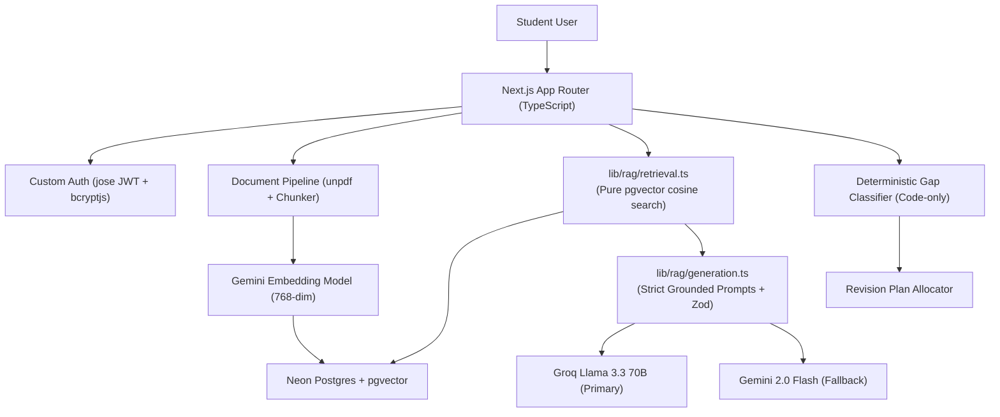

# GapFinder AI ("Find What the Student Doesn't Know")

GapFinder AI is a diagnostic learning web application built specifically for students. It pinpoints knowledge gaps from uploaded study materials (syllabi, textbooks, lecture notes, and past papers), generates grounded diagnostic assessments, computes deterministic gap classifications, and builds adaptive revision plans.

---

## 1. Core Feature Overview

- **Material Ingestion & Verification**: Upload PDFs and text files (up to 4 MB). Text extracted per page with `unpdf`, cleaned, chunked into paragraph-bounded segments with page tracking, and embedded via Gemini embeddings into Neon Postgres (`pgvector`).
- **Syllabus-Derived Topic Map**: Automatically extracts chapters, topics, and subtopics grounded strictly with verbatim source quotes from syllabus documents. Cross-maps topics against textbook sections and past exam questions.
- **Diagnostic Quiz & Quality Gates**: Generates multiple choice questions (MCQ) testing targeted topics. Every question includes 4 options, 1 correct answer, an explanation, distractor notes, verbatim supporting quotes, and document citations. Validated with deduplication and secondary solver verification.
- **Deterministic Gap Analysis**: Computes topic accuracy without LLM opinions using configurable thresholds. Classifies topics into **Weak**, **Medium**, **Strong**, or **Insufficient Data** (< 2 attempts), complete with human-readable generated reasons and recency weighting across attempts.
- **Adaptive Revision Plan**: Allocates daily study minutes prioritizing weak areas while preserving a maintenance share for strong topics and a final diagnostic retest. When new quizzes are submitted, the plan automatically adapts to new gap results while carrying over completed tasks.
- **Explain-This-Topic Assistant**: Streams grounded explanations answering only from uploaded documents with inline citations and sources lists. Out-of-scope queries honestly return an insufficient context notice.
- **Progress Dashboard**: Tracks total assessments, accuracy trends, topic improvement from first to latest attempt, score progression over attempts, and active revision plan completion.

---

## 2. Architecture & RAG Pipeline



### Clean Separation of Retrieval & Generation
- `lib/rag/retrieval.ts`: Strictly handles query normalization, embedding generation, and exact cosine distance search against `pgvector` filtered by `user_id` and `subject_id`. It performs no LLM generation.
- `lib/rag/generation.ts`: Receives retrieved context chunks only, builds grounded prompts, enforces prompt-injection defenses, validates responses against Zod schemas, and maps chunk metadata into verifiable citations (`{ document, page }`).

---

## 3. Database Schema Summary

The database is powered by **Neon Postgres with pgvector**:

- `users`: User accounts (`id`, `email`, `name`, `password_hash`, `created_at`)
- `login_attempts`: Database-backed rate limiting per email/IP
- `subjects`: Student subjects scoped to `user_id`
- `documents`: Uploaded files with SHA-256 `content_hash` for duplicate detection
- `chunks`: Extracted text chunks with `page_start`, `page_end`, and `embedding vector(768)`
- `topics`: Hierarchical syllabus tree (`chapter`, `topic`, `subtopic`) with verbatim `source_quote`
- `topic_chunks`: Cross-mapping table linking topics to content chunks with similarity scores
- `past_paper_questions`: Extracted exam questions linked to topics
- `quizzes`: Quiz requests and statuses
- `questions`: Verified MCQs with 4 options, `correct_index`, citations, and supporting quotes
- `attempts`: User quiz submissions with deterministic scores
- `responses`: Per-question student choices (`is_correct`)
- `gap_reports` & `gap_report_items`: Stored deterministic gap analyses with accuracy and reasons
- `revision_plans` & `plan_tasks`: Multi-day revision schedules with completion tracking and versioning

---

## 4. Threshold & Parameter Configuration

All thresholds are centralized in `src/lib/config.ts` and can be overridden via environment variables:

| Variable | Default | Purpose |
| :--- | :--- | :--- |
| `STRONG_THRESHOLD` | `0.75` | Accuracy >= 75% classified as Strong |
| `MEDIUM_THRESHOLD` | `0.50` | Accuracy 50% - 74% classified as Medium (< 50% is Weak) |
| `MIN_ATTEMPTS_FOR_CLASSIFICATION` | `2` | Below 2 attempts classified as `insufficient_data` |
| `LOW_CONFIDENCE_MAX_ATTEMPTS` | `4` | 2-4 attempts marked with "(Low confidence)" flag |
| `RECENCY_WEIGHT` | `0.6` | 60% weight to latest attempt in cumulative calculations |
| `SIMILARITY_THRESHOLD` | `0.7` | Cosine similarity floor for retrieval chunks |
| `EMBEDDING_DIMENSION` | `768` | Fixed vector dimension for pgvector |

---

## 5. Local Setup & Development

### Prerequisites
- Node.js 18+ (tested on Node v20)
- npm or pnpm
- Neon PostgreSQL database URL with pgvector extension enabled

### Installation
1. Clone the repository:
   ```bash
   git clone <repo-url>
   cd Igebra/Igebra
   ```

2. Install dependencies:
   ```bash
   npm install
   ```

3. Set up environment variables:
   Copy `.env.example` to `.env.local` and populate required keys:
   ```bash
   cp .env.example .env.local
   ```
   Required keys:
   - `DATABASE_URL`: Neon PostgreSQL connection string
   - `AUTH_SECRET`: Random 32-byte secret for JWT signing
   - `GROQ_API_KEY`: Groq Cloud API key
   - `GEMINI_API_KEY`: Google AI Studio API key

4. Run migrations and database seed:
   ```bash
   npm run db:migrate
   npm run db:seed
   ```

5. Run test suite:
   ```bash
   npm test
   ```

6. Start local development server:
   ```bash
   npm run dev
   ```
   Open [http://localhost:3000](http://localhost:3000) in your browser.

---

## 6. Demo Account Credentials

- **Email**: `demo@gapfinder.ai`
- **Password**: `demo1234`

The demo user starts with an empty workspace so you can test uploading materials from scratch (or use the sample text files provided in the `samples/` folder).

---

## 7. Known Limitations

- **Scanned Image PDFs**: OCR is intentionally excluded. Scanned or image-only PDFs lacking a digital text layer are rejected with a clear notification.
- **File Size Limit**: Single file upload limit is capped at 4 MB in accordance with serverless request body constraints.

